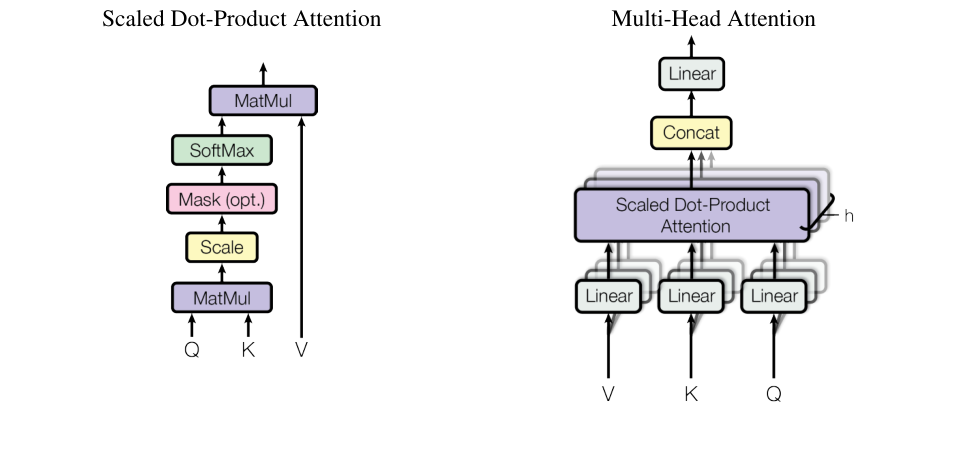

## 定義

多頭注意力不只執行一次注意力函數，而是把 Query、Key、Value 用不同的可學習線性投影各投影 $h$ 次，平行計算注意力後再合併（[Vaswani et al., 2017](../papers/vaswani-2017-attention-is-all-you-need.md)，§3.2.2）。

## 運作方式

Figure 2：縮放點積注意力（左）與多頭注意力（右）。來源：Vaswani et al., 2017，依論文首頁聲明於學術用途重製。

計算方式如下（§3.2.2），其中的 $\mathrm{Attention}$ 是[縮放點積注意力](../concepts/scaled-dot-product-attention.md)：

$$
\mathrm{MultiHead}(Q,K,V)=\mathrm{Concat}(\mathrm{head}_1, \dots, \mathrm{head}_h)W^O
$$

$$
\mathrm{head}_i=\mathrm{Attention}(QW_i^Q, KW_i^K, VW_i^V)
$$

投影矩陣的維度為 $W_i^Q, W_i^K \in \mathbb{R}^{d_{\text{model}} \times d_k}$、$W_i^V \in \mathbb{R}^{d_{\text{model}} \times d_v}$、$W^O \in \mathbb{R}^{hd_v \times d_{\text{model}}}$（§3.2.2）。

論文採用 $h=8$，每個頭的 $d_k=d_v=d_{\text{model}}/h=64$。因為每個頭的維度縮小了，總計算成本和全維度的單頭注意力相近（§3.2.2）。

## 為什麼重要

多頭注意力讓模型能同時關注不同位置、不同表示子空間的資訊。單頭注意力的平均效果會抑制這種能力（§3.2.2）。作者也用它來彌補對注意力加權平均造成的有效解析度下降（§2）。

Table 3 在固定計算量下比較不同頭數（§6.2）：

| 頭數 $h$ | $d_k=d_v$ | 開發集 BLEU |
|---|---|---:|
| 1 | 512 | 24.9 |
| 4 | 128 | 25.5 |
| 8（基礎模型） | 64 | 25.8 |
| 16 | 32 | 25.8 |
| 32 | 16 | 25.4 |

作者的結論是：單頭比最佳設定低 0.9 BLEU，但頭數太多品質也會下降（§6.2）。

從視覺化結果來看，不同的頭似乎學到不同任務，有些和句子的語法與語意結構有關（§4、Figure 3 至 5）。

## 在各論文中的發展

- [Vaswani et al., 2017](../papers/vaswani-2017-attention-is-all-you-need.md)（§3.2.2）：提出多頭注意力，並以三種方式用在 [Transformer](../models/transformer.md) 中：編碼器－解碼器注意力、編碼器自注意力、解碼器自注意力（§3.2.3）。

## 相關頁面

- [Attention Is All You Need](../papers/vaswani-2017-attention-is-all-you-need.md)：提出這個結構的論文
- [Transformer](../models/transformer.md)：使用這個結構的模型
- [縮放點積注意力](../concepts/scaled-dot-product-attention.md)：每個頭內部的計算方式
- [自注意力](../concepts/self-attention.md)：多頭注意力在模型中的主要用法
