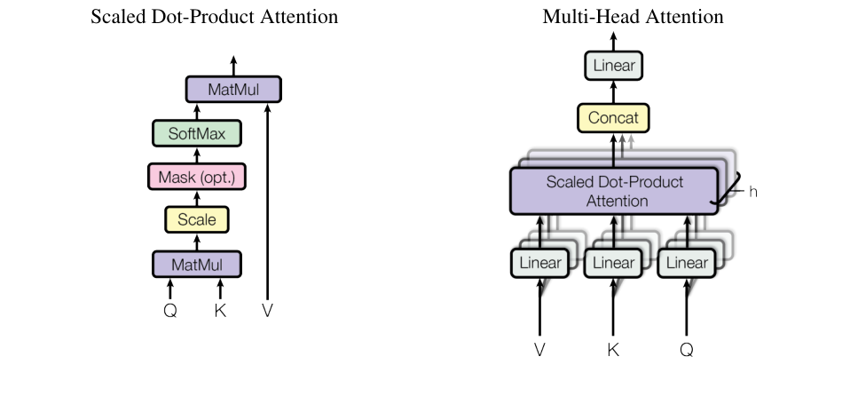

## 定義

注意力函數把一個 Query 和一組 Key-Value 配對對應到一個輸出。輸出是 Value 的加權總和，權重則由 Query 與對應 Key 的相容性函數決定（[Vaswani et al., 2017](../papers/vaswani-2017-attention-is-all-you-need.md)，§3.2）。

縮放點積注意力以點積作為相容性函數，並除以 $\sqrt{d_k}$ 縮放（§3.2.1）。

## 運作方式

Figure 2：縮放點積注意力（左）與多頭注意力（右）。來源：Vaswani et al., 2017，依論文首頁聲明於學術用途重製。

計算步驟如下（§3.2.1）：

1. 計算 Query 與所有 Key 的點積。
2. 每個點積除以 $\sqrt{d_k}$。
3. 用 softmax 取得 Value 的權重。

實際運算時，一組 Query 會一起放進矩陣 $Q$，Key 與 Value 分別放進 $K$ 與 $V$（§3.2.1，式 1）：

$$
\mathrm{Attention}(Q,K,V)=\mathrm{softmax}\left(\frac{QK^T}{\sqrt{d_k}}\right)V
$$

需要遮罩時，把不合法連結在 softmax 輸入中對應的值設為 $-\infty$（§3.2.3）。

**解讀：** 可以把它想成模糊的查表。Query 是要找的內容，Key 是每筆資料的標籤，Value 是資料內容。Query 和 Key 越相符，對應的 Value 在輸出中占的比重越高。

## 為什麼重要

### 為什麼用點積

常見的注意力函數有加法注意力（additive attention）與點積注意力兩種。兩者的理論複雜度相近，但點積注意力可以使用高度最佳化的矩陣乘法程式，實際上快很多，也較省空間（§3.2.1）。

### 為什麼要縮放

$d_k$ 較小時兩種注意力表現相近，但 $d_k$ 較大時，沒有縮放的點積注意力比加法注意力差。作者推測這是因為點積的數值變得太大，把 softmax 推進梯度極小的區域，因此除以 $\sqrt{d_k}$ 來抵消這個效應（§3.2.1）。

作者用以下假設說明點積為何會變大：若 $q$ 與 $k$ 的各分量是平均數 0、變異數 1 的獨立隨機變數，則 $q \cdot k$ 的平均數為 0、變異數為 $d_k$（§3.2.1，註腳 4）。

**解讀：** 依這個假設，除以 $\sqrt{d_k}$ 後變異數會回到 1，所以不論 $d_k$ 多大，點積的數值範圍都維持穩定。

## 在各論文中的發展

- [Vaswani et al., 2017](../papers/vaswani-2017-attention-is-all-you-need.md)（§3.2.1）：提出這個名稱與縮放做法，並作為 [Transformer](../models/transformer.md) 的基本注意力函數。作者也觀察到縮小 $d_k$ 會降低品質，認為比點積更複雜的相容性函數可能有幫助（§6.2）。

## 相關頁面

- [Attention Is All You Need](../papers/vaswani-2017-attention-is-all-you-need.md)：提出這個方法的論文
- [Transformer](../models/transformer.md)：使用這個方法的模型
- [多頭注意力](../concepts/multi-head-attention.md)：平行執行多組縮放點積注意力
- [自注意力](../concepts/self-attention.md)：Query、Key、Value 來自同一處時的用法
- [Bahdanau 2014](../reference/bahdanau-2014-neural-machine-translation.md)：Vaswani et al. 列為加法注意力來源的文獻

## 待補

- 值得之後開頁的主題：加法注意力
