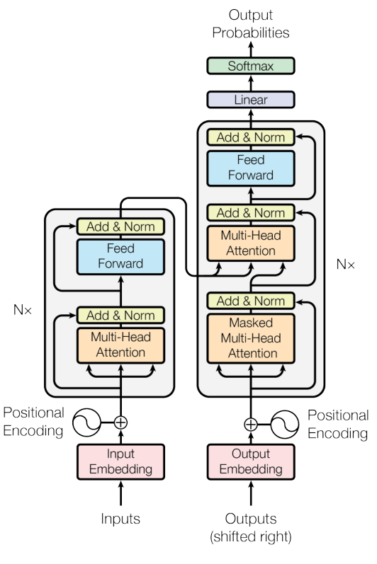

## 概要

Transformer 是 [Vaswani et al., 2017](../papers/vaswani-2017-attention-is-all-you-need.md) 提出的序列轉換模型，完全以注意力機制取代循環與卷積。作者稱它是第一個完全依靠自注意力計算輸入與輸出表示的轉換模型（§2）。論文中用於機器翻譯與英文成分句法剖析。

## 架構

Figure 1：Transformer 模型架構。來源：Vaswani et al., 2017，依論文首頁聲明於學術用途重製。

### 資料流程

1. 輸入 token 經過可學習的嵌入，乘上 $\sqrt{d_{\text{model}}}$，再加上[位置編碼](../concepts/positional-encoding.md)（§3.4、§3.5）。
2. 編碼器把輸入序列 $(x_1, \dots, x_n)$ 轉換成連續表示 $\mathbf{z}=(z_1, \dots, z_n)$（§3）。
3. 解碼器根據 $\mathbf{z}$ 一次生成一個符號，並把先前生成的符號當作額外輸入（§3）。
4. 解碼器輸出經過線性轉換與 softmax，得到下一個 token 的機率。兩個嵌入層與這個線性轉換共用同一個權重矩陣（§3.4）。

### 編碼器與解碼器

| 元件 | 子層 | 出處 |
|---|---|---|
| 編碼器層 | 多頭自注意力 → 前饋網路 | §3.1 |
| 解碼器層 | 遮罩多頭自注意力 → 編碼器－解碼器注意力 → 前饋網路 | §3.1 |

每個子層的輸出都是 $\mathrm{LayerNorm}(x + \mathrm{Sublayer}(x))$，也就是殘差連接加上層正規化（§3.1）。

解碼器的遮罩，加上輸出嵌入向右位移一個位置，確保位置 $i$ 的預測只依賴小於 $i$ 的已知輸出（§3.1）。

### 三種注意力的用法

模型用[多頭注意力](../concepts/multi-head-attention.md)的方式有三種（§3.2.3）：

- **編碼器－解碼器注意力**：Query 來自前一個解碼器層，Key 與 Value 來自編碼器輸出，讓解碼器每個位置都能關注輸入的所有位置。
- **編碼器[自注意力](../concepts/self-attention.md)**：每個位置都能關注前一層的所有位置。
- **解碼器自注意力**：每個位置只能關注自己與之前的位置，以維持自迴歸特性。

### 逐位置前饋網路

每層另有一個前饋網路，以相同方式分別作用於每個位置。它由兩個線性轉換與中間的 ReLU 構成，同一層內各位置參數相同，不同層則參數不同（§3.3，式 2）：

$$
\mathrm{FFN}(x)=\max(0, xW_1+b_1)W_2+b_2
$$

## 關鍵規格

| 項目 | 基礎模型 | 大模型 | 出處 |
|---|---|---|---|
| 層數 $N$ | 6 | 6 | Table 3 |
| $d_{\text{model}}$ | 512 | 1024 | Table 3 |
| $d_{ff}$ | 2048 | 4096 | Table 3 |
| 注意力頭數 $h$ | 8 | 16 | Table 3 |
| $d_k = d_v$ | 64 | 64 | Table 3 |
| Dropout $P_{drop}$ | 0.1 | 0.3 | Table 3 |
| 標籤平滑 $\epsilon_{ls}$ | 0.1 | 0.1 | Table 3 |
| 訓練步數 | 10 萬 | 30 萬 | Table 3 |
| 參數量 | 6500 萬 | 2.13 億 | Table 3 |

大模型的 $d_k$、$d_v$ 與 $\epsilon_{ls}$ 在 Table 3 中未列，依該表說明視為與基礎模型相同。英法翻譯的大模型則使用 $P_{drop}=0.1$（§6.1）。

## 表現

| 任務 | 指標 | 結果 | 出處 |
|---|---|---|---|
| WMT 2014 英德翻譯 | BLEU | 基礎 27.3；大模型 28.4 | Table 2 |
| WMT 2014 英法翻譯 | BLEU | 基礎 38.1；大模型 41.8 | Table 2 |
| WSJ 成分句法剖析（僅 WSJ） | F1 | 91.3（4 層） | Table 4 |
| WSJ 成分句法剖析（半監督） | F1 | 92.7（4 層） | Table 4 |

> **矛盾：** 英法翻譯的大模型 BLEU，論文摘要與 Table 2 為 41.8，但 §6.1 內文寫 41.0。詳見[論文頁](../papers/vaswani-2017-attention-is-all-you-need.md)。

## 與其他模型的關係

以下比較皆來自原論文，分數為 newstest2014 的 BLEU（Table 2）。

| 模型 | 架構類型 | 英德 BLEU | 英法 BLEU |
|---|---|---|---|
| GNMT + RL | 循環 | 24.6 | 39.92 |
| ByteNet | 卷積 | 23.75 | 未列 |
| ConvS2S | 卷積 | 25.16 | 40.46 |
| Transformer（大） | 注意力 | 28.4 | 41.8 |

**解讀：** 表中的架構類型是依論文的敘述所作的歸類：§2 說明 ByteNet 與 ConvS2S 使用卷積，§1 則把 GNMT 的文獻列在循環語言模型與編碼器－解碼器架構的研究之中。Table 2 本身沒有標示類型。

後續模型方面，Wiki 目前收錄兩篇摘要：[BERT](../reference/devlin-2018-bert.md) 把 Transformer 用於預訓練語言模型，[Vision Transformer](../reference/dosovitskiy-2020-vision-transformer.md) 則用於影像分類。

## 相關頁面

- [Attention Is All You Need](../papers/vaswani-2017-attention-is-all-you-need.md)：提出本模型的論文
- [縮放點積注意力](../concepts/scaled-dot-product-attention.md)：模型使用的注意力計算方式
- [多頭注意力](../concepts/multi-head-attention.md)：模型的注意力結構
- [自注意力](../concepts/self-attention.md)：編碼器與解碼器的核心
- [位置編碼](../concepts/positional-encoding.md)：模型取得順序資訊的方式
- [Devlin 2018：BERT](../reference/devlin-2018-bert.md)：把這個架構用於預訓練語言模型
- [Dosovitskiy 2020：Vision Transformer](../reference/dosovitskiy-2020-vision-transformer.md)：把這個架構用於影像分類

## 待補

- 值得之後開頁的主題：編碼器－解碼器架構、ConvS2S、GNMT、標籤平滑
