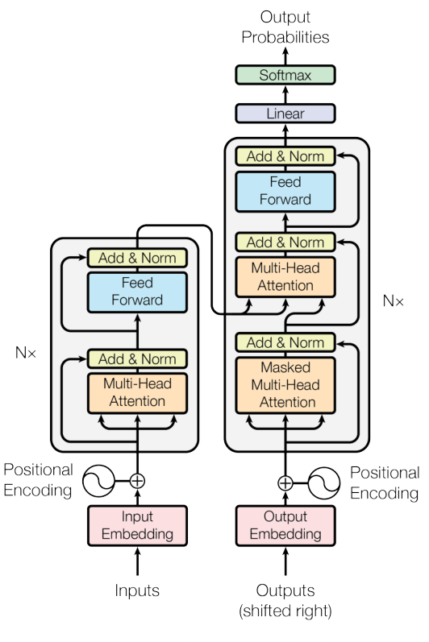

## 一句話總結

這篇論文提出 [Transformer](../models/transformer.md)：完全以注意力機制（attention mechanism）構成、不使用循環與卷積的序列轉換模型，在機器翻譯上同時提升了品質並大幅降低訓練成本。

作者皆為同等貢獻，排名順序為隨機（第 1 頁註腳）。本頁依據 arXiv v7 版本。

## 解決的問題

當時主流的序列轉換（sequence transduction）模型，是以循環或卷積神經網路構成的編碼器－解碼器（encoder-decoder）架構，表現最好的模型還會再加上注意力機制（§1）。作者指出兩類做法的限制：

- **循環模型難以平行化**：計算必須沿著序列位置依序進行，無法在單一訓練樣本內平行處理。序列越長，問題越嚴重（§1）。
- **卷積模型難以學習遠距離依賴**：連結兩個位置所需的運算量會隨距離增加，ConvS2S 為線性成長，ByteNet 為對數成長（§2）。

Transformer 把連結任意兩個位置的運算數降為常數，但對注意力加權平均會降低有效解析度，因此作者再以[多頭注意力](../concepts/multi-head-attention.md)來彌補（§2）。

## 核心方法

Figure 1：Transformer 模型架構。來源：Vaswani et al., 2017，依論文首頁聲明於學術用途重製。

模型的主要元件與基礎設定如下，完整說明見 [Transformer](../models/transformer.md)。

- **編碼器與解碼器**：各由 $N=6$ 層相同的層堆疊而成，每個子層都使用殘差連接（residual connection）與層正規化（layer normalization）（§3.1）。
- **[縮放點積注意力](../concepts/scaled-dot-product-attention.md)**：以 $\sqrt{d_k}$ 縮放點積，避免 softmax 落入梯度極小的區域（§3.2.1）。
- **[多頭注意力](../concepts/multi-head-attention.md)**：平行執行 $h=8$ 組注意力，讓模型能同時關注不同的表示子空間（§3.2.2）。
- **[自注意力](../concepts/self-attention.md)**：Query、Key、Value 來自同一處，取代循環層（§3.2.3）。
- **[位置編碼](../concepts/positional-encoding.md)**：用不同頻率的正弦與餘弦函數提供順序資訊（§3.5）。

### 為什麼選擇自注意力

作者從每層計算複雜度、可平行化程度、最長路徑長度三個面向比較（§4、Table 1），詳見[自注意力](../concepts/self-attention.md)頁面。結論是：自注意力只需常數個依序運算就能連結所有位置，而循環層需要 $O(n)$ 個。

### 訓練設定

| 項目 | 設定 | 出處 |
|---|---|---|
| 英德資料 | WMT 2014，約 450 萬句對，byte-pair encoding，詞彙量約 37000 | §5.1 |
| 英法資料 | WMT 2014，3600 萬句，word-piece，詞彙量 32000 | §5.1 |
| 批次大小 | 來源與目標各約 25000 個 token | §5.1 |
| 硬體 | 單一機器，8 張 NVIDIA P100 GPU | §5.2 |
| 訓練時間 | 基礎模型 10 萬步（12 小時），大模型 30 萬步（3.5 天） | §5.2 |
| 優化器 | Adam，$\beta_1=0.9$、$\beta_2=0.98$、$\epsilon=10^{-9}$ | §5.3 |
| Dropout | 基礎模型 $P_{drop}=0.1$，用於子層輸出及嵌入與位置編碼的總和 | §5.4 |
| 標籤平滑 | $\epsilon_{ls}=0.1$，會使 perplexity 變差，但提升準確率與 BLEU | §5.4 |

學習率先線性上升，之後依步數平方根的倒數下降，其中 $warmup\_steps=4000$（§5.3，式 3）：

$$
lrate = d_{\text{model}}^{-0.5} \cdot \min\left(step\_num^{-0.5},\ step\_num \cdot warmup\_steps^{-1.5}\right)
$$

## 實驗與結果

### 機器翻譯

以下節選自 Table 2，測試資料為 newstest2014。

| 模型 | 英德 BLEU | 英法 BLEU | 訓練成本（FLOPs） |
|---|---|---|---|
| ConvS2S | 25.16 | 40.46 | 英德 $9.6 \cdot 10^{18}$；英法 $1.5 \cdot 10^{20}$ |
| GNMT + RL Ensemble | 26.30 | 41.16 | 英德 $1.8 \cdot 10^{20}$；英法 $1.1 \cdot 10^{21}$ |
| ConvS2S Ensemble | 26.36 | 41.29 | 英德 $7.7 \cdot 10^{19}$；英法 $1.2 \cdot 10^{21}$ |
| Transformer（基礎） | 27.3 | 38.1 | $3.3 \cdot 10^{18}$ |
| Transformer（大） | **28.4** | **41.8** | $2.3 \cdot 10^{19}$ |

- 英德翻譯：大模型比先前最佳結果（含集成模型）高出 2.0 BLEU 以上（§6.1）。
- 英法翻譯：大模型是當時最佳的單一模型，訓練成本不到先前最佳模型的四分之一（§6.1）。
- 翻譯的推論設定為 beam size 4、長度懲罰 $\alpha=0.6$，超參數由開發集決定（§6.1）。

> **矛盾：** 英法翻譯的大模型 BLEU，論文摘要與 Table 2 為 41.8，但 §6.1 內文寫 41.0。本 Wiki 暫採摘要與 Table 2 的 41.8，因為有兩處一致，尚未有其他來源可查證。

### 模型變體

Table 3 改變基礎模型的設定，比較各元件的影響。這些結果是在開發集 newstest2013 上的英德翻譯，且沒有使用 checkpoint 平均，所以不能直接和上表比較（§6.2、Table 3）。

| 變體 | 改動 | BLEU | 參數量（百萬） |
|---|---|---|---|
| 基礎模型 | $N=6$、$d_{\text{model}}=512$、$h=8$ | 25.8 | 65 |
| 單頭 | $h=1$、$d_k=d_v=512$ | 24.9 | 未列（同基礎） |
| 16 頭 | $h=16$、$d_k=d_v=32$ | 25.8 | 未列（同基礎） |
| 32 頭 | $h=32$、$d_k=d_v=16$ | 25.4 | 未列（同基礎） |
| 2 層 | $N=2$ | 23.7 | 36 |
| 無 Dropout | $P_{drop}=0.0$ | 24.6 | 未列（同基礎） |
| 學習式位置嵌入 | 取代正弦位置編碼 | 25.7 | 未列（同基礎） |
| 大模型 | $d_{\text{model}}=1024$、$d_{ff}=4096$、$h=16$、$P_{drop}=0.3$、30 萬步 | 26.4 | 213 |

作者由此得出的觀察（§6.2）：

- 單頭比最佳設定低 0.9 BLEU，但頭數太多品質也會下降。
- 縮小 $d_k$ 會降低品質，代表判斷相容性並不容易，比點積更複雜的相容性函數可能有幫助。
- 模型越大越好，dropout 對避免過擬合很有幫助。

### 英文句法剖析

為了測試泛化能力，作者用 4 層、$d_{\text{model}}=1024$ 的 Transformer 做英文成分句法剖析，除少數超參數外都沿用英德翻譯的基礎模型設定（§6.3）。

| 訓練設定 | Transformer 的 WSJ 23 F1 | 同設定最高的其他模型 |
|---|---|---|
| 僅用 WSJ（約 4 萬句） | 91.3 | 91.7（Dyer et al., 2016） |
| 半監督（約 1700 萬句） | 92.7 | 92.1（McClosky et al., 2006；Vinyals & Kaiser et al., 2014） |

> **矛盾：** §6.3 內文說 Transformer 優於所有先前模型，唯一例外是 Recurrent Neural Network Grammar（Dyer et al., 2016）。但 Table 4 中 Luong et al. (2015) 的多工模型為 93.0，也高於 Transformer 半監督的 92.7。

**解讀：** 這可能是因為多工模型的訓練設定和 Transformer 不同，作者未將其視為直接比較的對象，但論文沒有明確說明。

### 注意力視覺化

論文附錄顯示，編碼器第 5 層的部分注意力頭會追蹤遠距離依賴，例如動詞「making」對應到「more difficult」（Figure 3）；也有注意力頭的行為看似與指代消解有關（Figure 4）。作者認為不同的頭學到了不同的任務，且自注意力可能帶來較好的可解釋性（§4、Figure 5）。

## 限制與後續影響

**作者提到的限制與後續方向：**

- 自注意力每層的複雜度為 $O(n^2 \cdot d)$，序列很長時成本高。作者提出可限制在大小為 $r$ 的鄰域內，代價是最長路徑增加為 $O(n/r)$，並列為未來工作（§4）。
- 實驗只涵蓋機器翻譯與句法剖析。作者計畫延伸到文字以外的輸入與輸出，例如圖片、音訊與影片，並讓生成過程減少依序計算（§7）。

**後續影響：** Wiki 目前收錄兩篇延伸研究的摘要。[BERT](../reference/devlin-2018-bert.md) 把 Transformer 用於預訓練語言模型，[Vision Transformer](../reference/dosovitskiy-2020-vision-transformer.md) 則把它用在影像分類，呼應了作者往文字以外延伸的計畫。

## 相關頁面

- [Transformer](../models/transformer.md)：本論文提出的模型
- [縮放點積注意力](../concepts/scaled-dot-product-attention.md)：本論文提出的注意力計算方式
- [多頭注意力](../concepts/multi-head-attention.md)：本論文提出的注意力結構
- [自注意力](../concepts/self-attention.md)：模型的核心，取代循環層
- [位置編碼](../concepts/positional-encoding.md)：模型取得順序資訊的方式
- [Bahdanau 2014](../reference/bahdanau-2014-neural-machine-translation.md)：本論文引用的文獻，是加法注意力的來源
- [Devlin 2018：BERT](../reference/devlin-2018-bert.md)：延伸研究，用於預訓練語言模型
- [Dosovitskiy 2020：Vision Transformer](../reference/dosovitskiy-2020-vision-transformer.md)：延伸研究，用於影像分類

## 待補

- 查證英法翻譯 BLEU 的 41.8 與 41.0 哪一個正確，例如對照 NIPS 正式版本
- 值得之後開頁的主題：循環神經網路與 LSTM、ConvS2S、加法注意力、殘差連接、層正規化、BLEU
